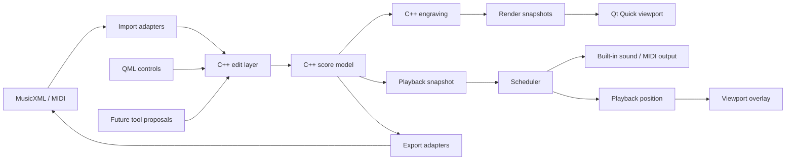

# Architecture

## Product direction

Music as Becoming is an open-source composition environment built around editable musical material and explicit ways to transform it. Its first milestone is a staff notation editor with MIDI and MusicXML import/export, MusicXML score save/reopen, and audible playback from a built-in sound source. External MIDI output may be added without becoming a requirement for listening.

Transformation ancestry, language-model control, plugin hosting, and programmable DSP belong to later stages. They build on the same editable score and keep generated results inspectable.

## Ownership and data flow

- **Score model:** C++ owns canonical musical semantics, exact musical time, and stable object identities. It has no QML, Python, music21, or renderer dependency. QtCore value types are allowed where they remain stable and efficient; Qt convenience does not define the musical model.
- **Edits:** The application/edit layer validates and applies changes, supports undo/redo, and reports consequences for layout and playback. The UI and future tools do not mutate score internals directly.
- **Import/export and persistence:** MusicXML and MIDI adapters translate between external formats and the C++ model without requiring Python. MusicXML is sufficient for score save/reopen in the first milestone. MIDI import requires explicit notation inference, such as quantization and voice assignment; MIDI events are not notation truth. A native project format is a later decision when relationships or other project-specific state need persistence.
- **Engraving and rendering:** C++ layout turns score semantics into renderable system/page snapshots. Invalidate only the region needed for correctness, including downstream reflow when necessary. The viewport draws visible systems/pages with a small prefetch margin, without one QML object per note.
- **Playback:** Musical timing produces a playback snapshot and event schedule independently of engraved coordinates. Scheduling and sound output do not rely on the UI event loop. A separate playhead overlay observes playback position without rebuilding static engraving. The first milestone provides sound without external MIDI hardware or another application.
- **QML/UI:** QML owns controls, presentation, and transient view state. It sends user actions to narrow C++ application APIs and receives render snapshots and lightweight state, not a mutable score graph.

Editing is unavailable while playback is running. The UI disables editing controls, and the application/edit layer rejects edit commands until playback stops. This policy can be revisited deliberately when editing during playback is designed.

## Process and thread boundaries

The UI and renderer follow Qt's thread rules. Expensive layout and analysis should be movable off the UI thread when safe. Workers receive immutable snapshots or explicit messages, never mutable score internals. The scheduler owns timing-sensitive work; it must not depend on QML timers or per-frame layout.

The first editor milestone works without Python, including MIDI and MusicXML interchange. Passage transformations run in a separate Python/music21 worker through bounded version 2 JSON-lines messages. The selected single-staff fragment, selection-relative key regions, and ordered operation parameters cross this boundary, with exact integer tick strings and explicit pitch/tie/tuplet data. The separate key-analysis command returns suggestions requiring confirmation. Python returns proposals; C++ validates them into independent scratch scores before display. Process I/O is asynchronous and serialization/result processing uses a C++ worker thread. Python failures leave notation editing and existing results usable. Future generators can extend this command boundary without changing canonical score ownership.

Key signature and tonal identity are C++ values in exact per-staff timelines. Tonality distinguishes major from minor and records the explicit minor collection. Undeclared imported context remains distinct from C major. Key edits use timeline patches and invalidate through the following key change's cancellation, rather than snapshotting the score. MusicXML carries standard signature/mode values plus versioned per-staff minor-form metadata. Pitch spelling remains explicit and independent from signatures; tuning and microtonal sounding pitch are later work.

Deterministic melody analysis uses a separate `analyze_melody` command under worker
protocol v2, with analysis schema 2 / algorithm `melody-v2`. Its immutable selected
snapshot includes the complete meter map, original event references, exact timing,
and selection-edge clipping information. Python extracts monophonic features,
ranked tonal candidates, boundary evidence, repetition families, and relationship
edges. C++ validates references, pitches, ties, ranges, counts, scores, and result
shape before installing an unchanged scratchpad copy. Bounded short-region
signatures add pitch equality, contour, exact returns and normalized rhythm.
Cells describe smaller patterns; gestures describe coherent shapes; automatic
motif proposals additionally require independent recurrence, grouping and identity
support. Evidence strength and structural salience remain distinct and inspectable.
Modal/pentatonic candidates
belong to analysis data and do not extend canonical key identities implicitly.

Each scratchpad optionally owns a validated analysis result and separate review
decisions. QML presents reports and findings through application APIs; it never
computes musical features. A document revision comparison marks analysis stale
without scanning score events, scheduling Python, or invalidating engraving.
Finding navigation uses the existing selection overlay. Serialization/validation
and large structured clipboard exports run on the C++ processing thread; analysis
itself runs in the sidecar. Indexed exact repetition and bounded approximate
matching avoid all-substring pairwise work. Limits are explicit in result notices.
Analysis/review persistence, generators, and manual region editing are deferred.

## Later composition and audio layers

The transformation workspace exposes ordered operations and editable musical results. Each result owns its C++ score, history, selection, and layout. Results share a single audio transport with the main document and can float or dock. Scratch material is temporary unless explicitly saved as MusicXML; workspace and ancestry persistence are deferred.

Interactive previews retain a frozen selected fragment and transformation parameters
in the C++ workspace. Adjustments coalesce for 150 ms (release flushes immediately)
and replace one locked scratch editor after asynchronous validation. Only that
fragment's layout is reset. The controller stops its own audition before replacement
and plays the latest valid preview once; another transport owner is never interrupted.
Hiding the workspace suspends audition without losing parameters. After 500 ms idle,
analysis consumes an immutable matching snapshot and attaches only a report, guarded
by request ID, editor lifetime and document revision. New adjustments supersede
analysis. Old reports remain visibly stale with finding actions disabled. Keep
unlocks the same scratch editor; Cancel removes it. Ordinary editing remains
unavailable during playback, including in a temporary preview.

Future transformation tools should expose their operation, inputs, parameters, and editable musical results. Derived material may retain ancestry and live dependencies; freezing a result would make it independent. Stable score identities and an intentional edit boundary support this direction without requiring the dependency system in the first milestone.

An optional, replaceable language model may translate natural-language requests into explicit operations. It must not become the source of musical truth or the only way to use the tools. Plugin instruments, parameter automation, and programmable DSP such as Faust are later layers with their own boundaries; no plugin or DSP implementation is selected here.

The reference large-score workload and responsiveness targets are in `AGENTS.md` and the `performance-guardrails` skill. Treat them as targets to measure against a deterministic fixture, not claims that already hold.
